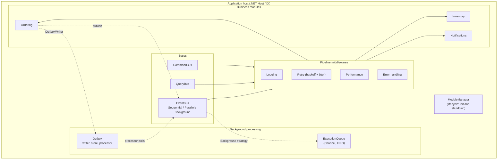
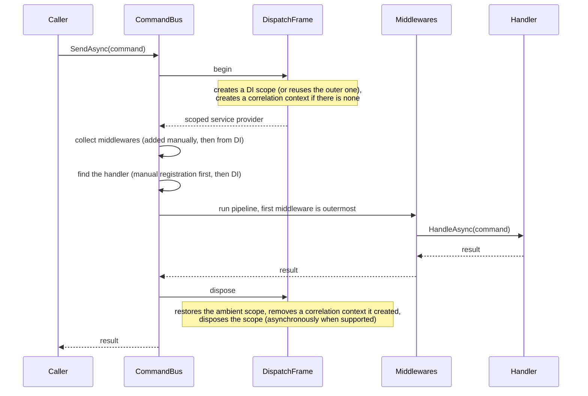
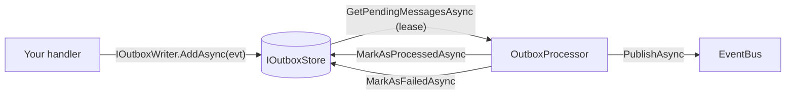

# MicroserviceMonolith

[](https://dotnet.microsoft.com/)
[](LICENSE)
[](https://github.com/mykolakushch/MicroserviceMonolith/actions/workflows/dotnet.yml)

**MicroserviceMonolith** is a lightweight .NET framework for building **modular monoliths**. It combines the operational simplicity of a single process with messaging patterns borrowed from microservices: CQRS buses, in-process events, pipeline middlewares, a background execution queue and an outbox.

> **Status:** early-stage. The in-memory components are reference implementations. Read [Guarantees and limitations](#guarantees-and-limitations) before relying on it: the built-in outbox is not durable, and module boundaries are a convention that you verify with an architecture test (see [Module boundaries](#module-boundaries)), not something the runtime enforces.

## Contents

- **[Part 1: How it works](#part-1-how-it-works)**: concepts, internals, guarantees
- **[Part 2: How to use it](#part-2-how-to-use-it)**: installation, step-by-step guide, recipes, troubleshooting
- [Upgrading](#upgrading) · [Releasing](#releasing-maintainers) · [Design decisions](#design-decisions) · [Tests](#running-the-tests) · [License](#license)

---

# Part 1: How it works

## The mental model

An application is a set of **modules**. A module owns a feature (Ordering, Inventory, Notifications): its handlers, services and state. Modules do not call each other's classes. They talk through three buses:

| Bus | Message | Handlers | Typical use |
|---|---|---|---|
| `ICommandBus` | `ICommand` / `ICommand<TResult>` | exactly one | "do this" (change state) |
| `IQueryBus` | `IQuery<TResult>` | exactly one | "tell me this" (read state) |
| `IEventPublisher` / `IEventSubscriber` | any class (usually `EventBase`) | zero or many | "this happened" (notify) |

Everything runs **in one process**, inside **one DI container**. There is no network and no serialization, so a dispatch costs a few allocations and a DI scope, not a round trip. The price is that isolation is a matter of discipline, which is why the framework gives you tools to check it.



## What happens when you dispatch a command

`QueryBus` and `EventBus` follow the same shape. The per-dispatch setup is shared code (`DispatchFrame`).



Key rules:

1. **Handler lookup.** A handler registered on the bus with `RegisterHandler` wins; otherwise the handler is resolved from DI. No handler means `InvalidOperationException("No command handler registered ...")`. `ICommandHandler<T>` (no result) inherits `ICommandHandler<T, Unit>`, so both registrations resolve.
2. **Scope per dispatch.** Every command, query and event publication gets its own DI scope, so scoped services (a `DbContext`, a unit of work) live exactly as long as one dispatch.
3. **Static dispatch.** The handler is chosen by the *static* type argument, not the runtime type. Events are not polymorphic: a handler of a base event type is not called for a derived event.
4. **Middleware order.** Middlewares added with `AddMiddleware` come first, then those registered in DI. The first one is the outermost wrapper (a "Russian doll").

## Scopes and lifetimes

| Situation | Scope |
|---|---|
| Default | each dispatch (command, query, publication) creates its own scope; a nested dispatch from a handler creates another |
| `ShareScopeBetweenNestedDispatches = true` | nested dispatches reuse the scope of the outermost dispatch; the outermost one owns and disposes it |
| `EventPublishStrategy.Parallel` | **every DI handler runs in a scope of its own**, with or without sharing, so concurrent handlers never share a `DbContext` |
| `EventPublishStrategy.Background` | the work outlives the publisher, so it always gets a fresh scope |

The shared scope is an `AsyncLocal` ambient value bound to the root provider that created it, so several containers in one process (for example in tests) never see each other's scopes.

Because a parallel handler lives in its own scope, the framework resolves the handler list once to count it, and resolves instance *i* inside scope *i*. For N handlers the handler objects are therefore constructed up to N times; the unused ones are discarded with their scope. Handler middlewares are shared between the parallel handlers and must be stateless.

## Correlation context

`CorrelationContext` (correlation id, causation id, user id, trace id, items) is an ambient value kept by `ICorrelationContextAccessor` (an `AsyncLocal` by default).

- The command and query buses **create a context if none is present** and **remove it again** when that dispatch ends. A context that already exists is never replaced or removed.
- The outbox writer **stamps** the current correlation and causation ids onto the stored message; the outbox processor **restores** them while delivering that message and puts the previous context back afterwards.
- `ExecutionQueue` and the `Background` event strategy carry the context of the code that enqueued the work. The queue's own worker tasks are started with the execution context flow suppressed, so they never inherit the context of whoever happened to create the queue.

## Events: delivery semantics

| Strategy | Behaviour |
|---|---|
| `Sequential` (default) | handlers run one after another in subscription order; the call completes when all have run |
| `Parallel` | all handlers are started together and awaited with `Task.WhenAll`; each DI handler has its own scope |
| `Background` | the publication is enqueued on the `ExecutionQueue` (handlers then run sequentially there) and `PublishAsync` returns immediately. Failures are logged, not thrown to the publisher |

**Failure isolation.** In `Sequential` and `Parallel`, a failing handler never prevents the others from running (a synchronous throw, an exception, or a timeout-style `OperationCanceledException` are all just failures). After every handler has run: one failure is rethrown with its original stack trace, several are thrown together as an `AggregateException`. Only cancellation of the *caller's* token stops a publication.

**Two middleware levels.** `IEventMiddleware` wraps the whole publication; `IEventHandlerMiddleware` wraps each subscriber on its own. Retry belongs on the handler level: when one subscriber fails and is retried, subscribers that already succeeded are not run again.

**Subscribers.** `IEventSubscriber.Subscribe` registers a lambda (it returns an `IDisposable` to unsubscribe); a class implementing `IEventHandler<TEvent>` is picked up from DI. Lambdas run in the publication's scope context but have no scope of their own.

## Execution queue

`ExecutionQueue` is a `Channel<T>` with one or more workers. `Enqueue` is non-blocking when the queue has room.

| `ExecutionQueueOptions` | Meaning |
|---|---|
| `Capacity` | `null` = unbounded; a number makes the queue bounded |
| `FullMode` | what a bounded queue does when full: `Wait` (the producer is refused: `Enqueue` throws `InvalidOperationException`, `EnqueueAsync` waits for room, `TryEnqueue` returns false), `DropOldest`, `DropWrite` (silently drop) |
| `WorkerCount` | number of concurrent workers (default 1) |
| `DrainTimeout` | how long disposal waits for queued work to finish |

A work item that throws is logged and the worker continues with the next item. After disposal, `Enqueue` throws `ObjectDisposedException`.

## Outbox

The outbox solves "change my data **and** publish an event, without losing the event if the process dies in between". You write the event to a store in the same transaction as your data; a processor delivers it afterwards.



- **Writer** (`IOutboxWriter`, scoped): creates an `OutboxMessage`, stamps the correlation ids, and saves it through the store. Nothing is written automatically when you call `PublishAsync`; you opt in per event by using the writer.
- **Store** (`IOutboxStore`): the built-in `InMemoryOutboxStore` is a reference implementation. It leases the messages it hands out (`LeaseDuration`, default 30 s) so concurrent processors do not dispatch the same message twice, retries failures with exponential backoff (`RetryBaseDelay`, `RetryMaxDelay`), and keeps messages that reached `MaxRetries` as dead letters you can inspect (`GetDeadLetters()`) and remove (`PurgeDeadLetters()`).
- **Processor** (`IOutboxProcessor`): resolves the store from a new DI scope for every batch (so a store may be scoped), restores each message's correlation context, publishes, then marks the message processed or failed. Cancellation by the caller does not count as a failure. A background hosted service polls it (`AutoProcessOutbox`).
- **Delivery is at-least-once.** If publishing succeeds but recording the result fails, or one of several subscribers fails, the message is delivered again. Subscribers must be idempotent.
- **Message form.** An `OutboxMessage` holds `EventType`, `SchemaVersion`, `Payload` (serialized event), `Headers`, correlation/causation ids, retry state, and, for messages created in this process, the live `Event` object. A durable store persists `EventType` + `SchemaVersion` + `Payload`. `IOutboxEventSerializer` (the built-in `JsonOutboxEventSerializer`) maps a **stable event name** to a CLR type and upgrades older schema versions, so stored messages survive type renames and schema changes. When `Event` is `null` (a message reloaded from the database) the processor recreates it from the payload; a message that cannot be recreated is marked failed instead of crashing the batch.

## Modules

An `IModule` has three hooks: `ConfigureServices` (register your services and handlers), `InitializeAsync` (run at startup), `ShutdownAsync` (run at shutdown).

**Discovery.** `AddMicroserviceMonolith` scans the assemblies you give it, in a deterministic order (types sorted by full name), in three phases:

1. Modules with a public parameterless constructor are instantiated, ordered by their `[ModuleDependsOn]` attributes, registered as `IModule` singletons, and their `ConfigureServices` runs. Services they register (including factory-registered handlers) exist before phase 2.
2. The remaining registrations are indexed.
3. Command, query and event handler classes (any visibility) are registered. If a handler for that command or query was already registered (by a module, a factory or an instance) the scanned class is skipped without error. If **two scanned classes** claim the same command or query, startup fails with `Ambiguous handler registration`. Open generic classes are ignored. A type that cannot be loaded (missing optional dependency) is skipped rather than failing the scan.

**Lifecycle.** `ModuleLifecycleHostedService` calls `InitializeModulesAsync` when the host starts and `ShutdownModulesAsync` when it stops (`AutoManageModuleLifecycle`).

- Initialization runs **dependencies first** (topological order from `[ModuleDependsOn]`; modules without dependencies keep their registration order). A circular dependency or a dependency on an unregistered module throws `InvalidOperationException` before any module starts.
- Each module is initialized at most once until a full shutdown, so calling `InitializeModulesAsync` yourself on top of the hosted service is harmless.
- Shutdown runs in **reverse order** and only for modules that were actually initialized. A module that throws during shutdown is logged and the remaining modules are still shut down.

## Module boundaries

Inside one DI container, nothing technically stops module A from using module B's internal classes. The framework therefore gives you a **boundary check** to run as an architecture test.

You describe each module by a namespace and declare which sub-namespaces are its public contracts (default: `<root>.Contracts`). `ModuleBoundaryValidator` inspects the compiled assemblies and reports every place where one module mentions a non-public type of another:

- base types and interfaces, field, property and event types, method and constructor signatures, local variables;
- **everything a method body refers to** in its IL: calls, object creation, field access, casts, type checks and generic arguments. Lambdas and async methods are covered because their generated types sit in the same namespace.

It does **not** see usage that is hidden by reflection or string-based resolution, and it is an architecture check, not a security boundary. Types that belong to no declared module (shared kernel, framework types) are unrestricted.

## Logging

The framework logs through `Microsoft.Extensions.Logging` (since 2.0 there is no separate logger abstraction). Failures are written at `Error`, slow-operation warnings at `Warning`, and the exception is passed to the logger as an exception, not only as text. Components that log on their own (module shutdown, the execution queue, the outbox processor and its background service, the background event strategy) resolve an `ILoggerFactory` from the container. Without logging registered (`services.AddLogging()` or a generic host) they stay silent.

The logging middleware writes a one-line failure summary (`Type: message`); the error-handling middleware writes the full exception with its stack trace, so adding both does not log the same stack twice.

## Guarantees and limitations

| Topic | What you get |
|---|---|
| Delivery | in-process, in order for `Sequential`; the outbox is at-least-once |
| Durability | **none by default.** The in-memory outbox loses messages on process exit. Implement `IOutboxStore` over your database for durability |
| Transactions | the writer participates in your transaction only if your store writes through the same unit of work |
| Command retry | **opt-in per command** (`[IdempotentCommand]`). Retrying a non-idempotent command can repeat its side effect |
| Query purity | read-only behaviour is a convention, not enforced |
| Module isolation | convention plus the boundary architecture test; not a runtime guarantee |
| Event dispatch | by static type, no polymorphism |
| Reflection | handlers are found by assembly scanning and invokers are created with reflection once per type. Native AOT and trimming are not supported |
| Threading | buses are thread-safe; handlers run on the caller's thread until their first real `await`, and `Parallel` handlers run concurrently |

---

# Part 2: How to use it

## Install

```sh
dotnet add package MicroserviceMonolith
```

Targets .NET 8 and .NET 9. It depends only on `Microsoft.Extensions.*` abstractions (DI, Logging, Configuration, Hosting).

## 1. Register the framework

```csharp
using Microsoft.Extensions.DependencyInjection;
using Microsoft.Extensions.Hosting;
using MicroserviceMonolith.Core.DependencyInjection;

var builder = Host.CreateApplicationBuilder(args);

builder.Services.AddMicroserviceMonolith(options =>
{
    // Scan for modules, command/query handlers and event handlers
    options.RegisterServicesFromAssemblyContaining<Program>();
    options.Configuration = builder.Configuration;
});

await builder.Build().RunAsync();
```

### Options

| Option | Default | Meaning |
|---|---|---|
| `RegisterServicesFromAssemblies(...)` / `RegisterServicesFromAssemblyContaining<T>()` | none | assemblies to scan |
| `Configuration` | empty | passed to `IModule.ConfigureServices` |
| `AutoManageModuleLifecycle` | `true` | initialize modules at host start, shut them down at stop |
| `ShareScopeBetweenNestedDispatches` | `false` | nested dispatches reuse the outer DI scope |
| `EnableOutbox` | `true` | register the outbox services |
| `AutoProcessOutbox` | `true` | run the background poller |
| `OutboxPollingInterval` | 1 s | pause between polls |
| `OutboxBatchSize` | 50 | messages per batch |
| `ExecutionQueueOptions` | see above | capacity, full mode, workers, drain timeout |

Calling `AddMicroserviceMonolith` twice is safe: services are registered with `TryAdd`, and each hosted service is registered once. Anything you register **before** the call (your own `ILogger`, `IOutboxStore`, `IOutboxEventSerializer`, ...) wins.

## 2. Define messages

```csharp
using MicroserviceMonolith.Core.Commands;
using MicroserviceMonolith.Core.Events;
using MicroserviceMonolith.Core.Queries;

public record CreateOrderCommand(string CustomerId, decimal Amount) : ICommand<Guid>;   // returns a result
public record CancelOrderCommand(Guid OrderId) : ICommand;                              // no result
public record GetOrderQuery(Guid OrderId) : IQuery<OrderDto>;
public record OrderDto(Guid Id, string CustomerId, decimal Amount);

public record OrderCreated(Guid OrderId, string CustomerId, decimal Amount) : EventBase;
```

## 3. Write handlers

```csharp
public sealed class CreateOrderHandler : ICommandHandler<CreateOrderCommand, Guid>
{
    private readonly IEventPublisher _events;
    public CreateOrderHandler(IEventPublisher events) => _events = events;

    public async Task<Guid> HandleAsync(CreateOrderCommand command, CancellationToken cancellationToken = default)
    {
        var id = Guid.NewGuid();
        // ... persist the order ...
        await _events.PublishAsync(new OrderCreated(id, command.CustomerId, command.Amount), cancellationToken);
        return id;
    }
}

public sealed class CancelOrderHandler : ICommandHandler<CancelOrderCommand>
{
    public Task HandleAsync(CancelOrderCommand command, CancellationToken cancellationToken = default)
        => Task.CompletedTask;
}

public sealed class GetOrderHandler : IQueryHandler<GetOrderQuery, OrderDto>
{
    public Task<OrderDto> HandleAsync(GetOrderQuery query, CancellationToken cancellationToken = default)
        => Task.FromResult(new OrderDto(query.OrderId, "c-1", 10m));
}
```

Handlers in scanned assemblies are registered automatically, whatever their visibility (an `internal` handler is fine). Handlers are resolved per dispatch, so constructor dependencies may be scoped services.

## 4. Send commands and queries

```csharp
public class OrdersController
{
    private readonly ICommandBus _commands;
    private readonly IQueryBus _queries;

    public OrdersController(ICommandBus commands, IQueryBus queries) { _commands = commands; _queries = queries; }

    public async Task<OrderDto> Place(string customerId, decimal amount)
    {
        Guid id = await _commands.SendAsync(new CreateOrderCommand(customerId, amount));
        return await _queries.QueryAsync(new GetOrderQuery(id));
    }
}
```

## 5. Publish and handle events

```csharp
// A DI handler: discovered automatically, may use scoped services
public sealed class SendEmailOnOrderCreated : IEventHandler<OrderCreated>
{
    public Task HandleAsync(OrderCreated e, CancellationToken ct = default) { /* ... */ return Task.CompletedTask; }
}

// Or subscribe a lambda at runtime
IDisposable subscription = subscriber.Subscribe<OrderCreated>((e, ct) => { /* ... */ return Task.CompletedTask; });
subscription.Dispose();   // unsubscribe

// Choose the strategy per publication
await publisher.PublishAsync(evt);                                      // Sequential
await publisher.PublishAsync(evt, EventPublishStrategy.Parallel);       // concurrent, one scope per handler
await publisher.PublishAsync(evt, EventPublishStrategy.Background);     // fire-and-forget on the ExecutionQueue
```

Rules of thumb: use `Sequential` when order or the transaction matters, `Parallel` for independent slow handlers, `Background` only for work you can afford to lose on a crash (use the outbox for work you cannot).

## 6. Organize code into modules

```csharp
using Microsoft.Extensions.Configuration;
using Microsoft.Extensions.DependencyInjection;
using MicroserviceMonolith.Core.Modules;

public class OrderingModule : ModuleBase
{
    public override string Name => "Ordering";

    public override void ConfigureServices(IServiceCollection services, IConfiguration configuration)
    {
        services.AddScoped<IOrderRepository, OrderRepository>();   // module-private services
    }

    public override Task InitializeAsync(IServiceProvider sp, CancellationToken ct = default)
    {
        // warm-up, subscriptions, ...
        return Task.CompletedTask;
    }

    public override Task ShutdownAsync(IServiceProvider sp, CancellationToken ct = default) => Task.CompletedTask;
}

// Ordering must be ready before Billing starts and stops after it
[ModuleDependsOn(typeof(OrderingModule))]
public class BillingModule : ModuleBase { /* ... */ }
```

- A module found by scanning needs a **public parameterless constructor**. A module that needs constructor dependencies must be registered yourself: `services.AddSingleton<IModule, MyModule>()`.
- Keep a module's internals in an `Internal` namespace and its cross-module messages (commands, queries, events, DTOs) in a `Contracts` namespace. That is exactly what the boundary test below checks.

## 7. Add middleware

Register middlewares in DI (they apply to every dispatch of that kind) or add them to a bus instance with `AddMiddleware`.

```csharp
using Microsoft.Extensions.Logging;

services.AddSingleton<ICommandMiddleware>(sp => new LoggingCommandMiddleware(
    sp.GetRequiredService<ILogger<ICommandMiddleware>>(),
    sp.GetService<ICorrelationContextAccessor>()));

services.AddSingleton<ICommandMiddleware>(sp => new PerformanceCommandMiddleware(
    TimeSpan.FromMilliseconds(500), sp.GetRequiredService<ILogger<ICommandMiddleware>>()));

services.AddSingleton<ICommandMiddleware>(sp => new ErrorHandlingCommandMiddleware(
    sp.GetRequiredService<ILogger<ICommandMiddleware>>()));
```

Use the factory form shown here: the middlewares have several constructors (`Microsoft.Extensions.Logging.ILogger`, plain delegate) and plain `AddSingleton<ICommandMiddleware, LoggingCommandMiddleware>()` can be ambiguous. Equivalent `*QueryMiddleware` and `*EventMiddleware` types exist. Order = registration order, first is outermost.

### Retry, and why commands are different

```csharp
// Queries: reads are safe to repeat
new RetryQueryMiddleware(3, logger);

// Commands: retried ONLY if marked idempotent
[IdempotentCommand]
public record SetOrderStatusCommand(Guid OrderId, string Status) : ICommand;

public record ChargeCardCommand(Guid OrderId, decimal Amount) : ICommand<Guid>;   // never retried by default

new RetryCommandMiddleware(maxRetries: 3, logger);
// To retry every command (you take responsibility, e.g. with idempotency keys):
new RetryCommandMiddleware(3, TimeSpan.FromMilliseconds(50), retryNonIdempotentCommands: true);

// Events: put retry on the per-subscriber level, so finished subscribers are not repeated
bus.AddHandlerMiddleware(new RetryEventMiddleware(3, logger));
```

Mark a command `[IdempotentCommand]` only if running it twice equals running it once (set a status, upsert by key, or deduplicate with an idempotency key). A retry after a timeout that happened *after* the work succeeded would otherwise repeat a charge or an email. Cancellation by the caller is never retried.

## 8. Use the correlation context

```csharp
public class MyHandler : ICommandHandler<MyCommand>
{
    private readonly ICorrelationContextAccessor _correlation;
    public MyHandler(ICorrelationContextAccessor correlation) => _correlation = correlation;

    public Task HandleAsync(MyCommand c, CancellationToken ct = default)
    {
        var id = _correlation.CorrelationContext?.CorrelationId;   // set for you by the bus
        return Task.CompletedTask;
    }
}

// At your entry point (HTTP middleware, message consumer), seed it from the incoming request
accessor.CorrelationContext = new CorrelationContext(incomingCorrelationId, userId: user);
```

Nested commands, queries, events, background work and outbox messages keep the same correlation id.

## 9. Background work with the execution queue

```csharp
services.AddMicroserviceMonolith(o =>
{
    o.ExecutionQueueOptions.WorkerCount = 4;
    o.ExecutionQueueOptions.Capacity = 1000;                       // bounded
    o.ExecutionQueueOptions.FullMode = BoundedChannelFullMode.Wait;
});

public class Mailer
{
    private readonly ExecutionQueue _queue;
    public Mailer(ExecutionQueue queue) => _queue = queue;

    public void SendLater(string to) =>
        _queue.Enqueue(async ct => { await Task.Delay(50, ct); /* send */ });
}
```

With a full bounded `Wait` queue `Enqueue` throws; use `await _queue.EnqueueAsync(...)` to wait for room or `TryEnqueue` to test.

## 10. The outbox

### In-memory (development, tests)

```csharp
public class PlaceOrderHandler : ICommandHandler<PlaceOrderCommand>
{
    private readonly IOutboxWriter _outbox;
    public PlaceOrderHandler(IOutboxWriter outbox) => _outbox = outbox;

    public async Task HandleAsync(PlaceOrderCommand c, CancellationToken ct = default)
    {
        // ... save your data ...
        await _outbox.AddAsync(new OrderCreated(c.OrderId, c.CustomerId, c.Amount), ct);
    }
}
```

The poller (on by default) delivers it to the subscribers of `OrderCreated`. To drive it manually, set `AutoProcessOutbox = false` and call `IOutboxProcessor.ProcessBatchAsync()`. Inspect failures with `((InMemoryOutboxStore)store).GetDeadLetters()`.

### Durable (production)

Implement `IOutboxStore` over your database and register it (a scoped registration is supported):

```csharp
services.AddScoped<IOutboxStore, EfOutboxStore>();   // your implementation
services.AddSingleton<IOutboxEventSerializer>(new JsonOutboxEventSerializer()
    .Register<OrderCreated>("ordering.order-created", schemaVersion: 1));
services.AddMicroserviceMonolith(...);
```

What a store must do:

| Method | Contract |
|---|---|
| `SaveAsync` | insert the message **in the caller's transaction** (use the same `DbContext`/connection as your data) |
| `GetPendingMessagesAsync(batchSize)` | return unprocessed, not dead-lettered messages that are due; **lease them** (for example set `LockedUntil` with an atomic update) so concurrent processors do not take the same rows |
| `MarkAsProcessedAsync` | mark delivered (or delete) |
| `MarkAsFailedAsync` | increment the retry count, store the error, set `NextAttemptOn` (backoff) |
| `MaxRetries` | the retry limit; at the limit a message is a dead letter |

Persist `EventType`, `SchemaVersion`, `Payload`, `CorrelationId`, `CausationId`, `OccurredOn` and the retry state. Leave `Event` null when loading: the processor recreates it through the serializer.

### Evolving an event

```csharp
// v1 had "Name"; v2 renamed it to "Title"
new JsonOutboxEventSerializer()
    .Register<OrderPlaced>("orders.order-placed", schemaVersion: 2)
    .RegisterUpcaster("orders.order-placed", fromVersion: 1, json => json.Replace("\"Name\"", "\"Title\""));
```

Messages already stored as version 1 are upgraded when they are read. Always keep the stable name; never reuse it for a different event.

## 11. Share one scope across a call chain

```csharp
options.ShareScopeBetweenNestedDispatches = true;
```

A command that sends another command, runs a query and publishes an event now uses the **same** scoped services throughout (one `DbContext`, one unit of work). `Parallel` event handlers and `Background` publications are the exception: they always get their own scopes.

## 12. Check module boundaries in a test

```csharp
using MicroserviceMonolith.Core.Architecture;

public class ArchitectureTests
{
    [Fact]
    public void Modules_only_use_each_others_contracts()
    {
        var modules = new[]
        {
            new ModuleBoundary("Ordering",  "Shop.Ordering"),    // public: Shop.Ordering.Contracts
            new ModuleBoundary("Billing",   "Shop.Billing"),
            new ModuleBoundary("Inventory", "Shop.Inventory", "Shop.Inventory.Contracts", "Shop.Inventory.Events"),
        };

        ModuleBoundaryValidator.AssertNoViolations(new[] { typeof(OrderingModule).Assembly }, modules);
    }
}
```

A failure lists every violation, for example: `Module 'Billing' uses 'Shop.Ordering.Internal.OrderRepository' of module 'Ordering' (body of Charge in Shop.Billing.ChargeHandler)`. Use `FindViolations` instead if you want to inspect them yourself.

## 13. Logging

Nothing to configure in a generic host: framework messages go to your `Microsoft.Extensions.Logging` providers. Outside a host call `services.AddLogging(...)` yourself, for example with a console provider. The middlewares take any `Microsoft.Extensions.Logging.ILogger` (or a plain `Action<string>` delegate), so your own sink is simply an `ILoggerProvider`.

## 14. Testing code that uses the framework

You do not need a host. Build a container and resolve the buses:

```csharp
var services = new ServiceCollection();
services.AddMicroserviceMonolith(o =>
{
    o.RegisterServicesFromAssemblyContaining<CreateOrderHandler>();
    o.AutoProcessOutbox = false;            // no background poller in tests
    o.AutoManageModuleLifecycle = false;    // or start the hosted services yourself
});
using var provider = services.BuildServiceProvider();

var id = await provider.GetRequiredService<ICommandBus>().SendAsync(new CreateOrderCommand("c-1", 10m));
```

Replace a dependency by registering your fake **before** `AddMicroserviceMonolith`, or override it afterwards with `services.Replace(...)`. For deterministic outbox tests give `InMemoryOutboxStore` a fake `TimeProvider` and call `ProcessBatchAsync()` yourself.

## Troubleshooting

| Message / symptom | Cause and fix |
|---|---|
| `No command handler registered for command 'X'` | the handler's assembly is not scanned (`RegisterServicesFromAssemblies`) or it is not registered; for a handler registered by hand check the exact generic interface |
| `Ambiguous handler registration: both A and B implement ICommandHandler<X>` | two scanned classes handle the same command or query. Keep one, or register the intended one by hand (a manual registration takes precedence) |
| `Circular module dependency: A -> B -> A` | fix the `[ModuleDependsOn]` attributes |
| `Module 'A' depends on 'B', which is not registered` | register or scan the missing module |
| My module's `ConfigureServices` never runs | it has no public parameterless constructor, so scanning skips it |
| `Enqueue` throws `InvalidOperationException` | the bounded `Wait` queue is full; use `EnqueueAsync`/`TryEnqueue` or raise `Capacity` |
| Outbox message stays pending | it is leased (wait for `LeaseDuration`), waiting for its retry time, or is a dead letter |
| Outbox message fails with "no IOutboxEventSerializer" | the store returned a message without an in-memory event and no serializer is registered (or the event type was not `Register`ed) |
| A command is not retried | by design: add `[IdempotentCommand]` or pass `retryNonIdempotentCommands: true` |
| Same exception logged twice | you are logging at both the call site and in a middleware, or both `Logging*` and `ErrorHandling*` are not the issue (the logging middleware logs a one-line summary only) |

## Running the showcase

```sh
cd FrameworkExample
dotnet run
```

It runs the Ordering, Inventory and Notification modules end to end, including the outbox.

---

## Upgrading

Behaviour changes since 1.0 that you may notice:

| Version | Change |
|---|---|
| 1.1 | `ExecutionQueue.Enqueue` throws when a bounded `Wait` queue is full or the queue is disposed (it used to spawn an unbounded `Task.Run`) |
| 1.2 | modules are initialized and shut down automatically by a hosted service |
| 1.3 | outbox: leasing, backoff, dead letters, scoped stores, `IOutboxWriter`, background poller |
| 1.4 | two scanned handlers for one command now fail at startup; modules can declare `[ModuleDependsOn]`; the framework logger uses `Microsoft.Extensions.Logging` when available and depends on `DependencyInjection.Abstractions` |
| 1.5 | opt-in `ShareScopeBetweenNestedDispatches` |
| 1.6 | `ILogger.Log(LogSeverity, string)`; module shutdown only for initialized modules |
| 1.7 | **`Parallel` handlers each get their own scope; command retry is opt-in (`[IdempotentCommand]`)** |
| 1.8 | outbox `Payload`/`SchemaVersion`/`Headers` and `IOutboxEventSerializer`; `OutboxMessage.Event` is nullable; `UserAction` moved to `MicroserviceMonolith.Adapters.UserActions` (the old `Core.UserActions` types remained as obsolete shims until 2.0) |
| 1.9 | `ModuleBoundaryValidator` |
| 2.0 | **breaking:** the framework `ILogger`, `LogSeverity`, `ConsoleLogger` and `MicrosoftLoggingAdapter` are removed; middleware, `ModuleManager`, `ExecutionQueue` and `OutboxProcessor` take `Microsoft.Extensions.Logging.ILogger`; the logger is no longer registered in the container and without `AddLogging()` nothing is logged. The obsolete `Core.UserActions` shims are removed (use `MicroserviceMonolith.Adapters.UserActions`) |

## Releasing (maintainers)

Merging to `main` runs CI (build and tests on .NET 8 and 9) but publishes nothing. A release is made by a tag:

1. Set `<Version>` in `MicroserviceMonolith/MicroserviceMonolith.csproj` (every change that is pushed bumps it) and merge to `main` with green CI.
2. Tag the merge commit with exactly that version and push the tag:
   ```sh
   git tag v2.0.0
   git push origin v2.0.0
   ```
3. The `Release and Publish` workflow verifies that the tag equals the csproj version, builds in Release, runs the tests, packs, publishes the package to **NuGet.org** (OIDC trusted publishing, no stored API key) and to GitHub Packages, and then creates the GitHub Release with generated notes and the binaries zip.

NuGet versions are immutable: a published version cannot be replaced, only superseded. The workflow can also be started manually (`workflow_dispatch`) when you need to re-run publishing.

## Design decisions

- **Scope.** An in-process framework for modular monoliths: modules, CQRS buses, events, middleware, an execution queue and an outbox contract. It is not a message broker, an ORM or a service host.
- **Persistence is yours.** The outbox ships the contract (`IOutboxStore`, `IOutboxEventSerializer`, leasing, retries, dead letters) and an in-memory store for development and tests. A durable store is implemented over your own database, so it can share your unit of work.
- **Reflection-based discovery.** Handlers and modules are found by assembly scanning at startup, with deterministic order and ambiguity detection. This keeps registration automatic and the API small; the cost is that Native AOT and trimming are not supported.
- **Boundaries by convention, checked in tests.** `ModuleBoundaryValidator` verifies module boundaries on compiled assemblies. There is no runtime isolation.
- **Static event types.** Events are dispatched by their exact type, which keeps routing explicit and predictable.
- **Logging.** The framework uses `Microsoft.Extensions.Logging` directly and adds no logging abstraction of its own.

## Running the tests

```sh
dotnet test
```

The suite covers the buses, event delivery and failure isolation, scopes, the execution queue, module lifecycle and dependencies, middlewares, the outbox (reliability, payloads, serializer), logging, assembly scanning and module boundaries.

## License

This project is licensed under the [MIT License](LICENSE).
