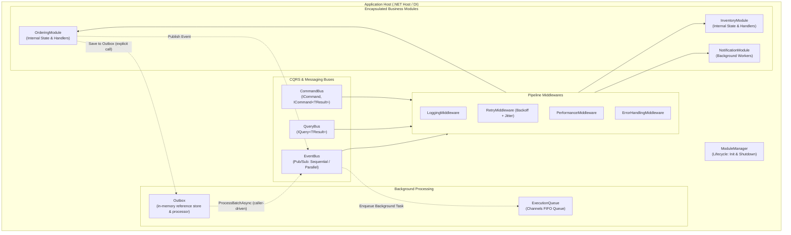

# MicroserviceMonolith

[](https://dotnet.microsoft.com/)
[](LICENSE)
[](https://github.com/mykolakushch/MicroserviceMonolith/actions/workflows/dotnet.yml)

**MicroserviceMonolith** is a lightweight .NET framework for building **Modular Monoliths**. It combines the operational simplicity of a single-process application with messaging patterns borrowed from microservices: CQRS, in-process event-driven communication, and pipeline middlewares.

> **Status:** early-stage. The in-memory components are reference implementations; see the notes in [Features](#features) for current limitations (e.g. the outbox is not durable, module boundaries are a convention and are not enforced by the framework).

---

## Architecture Overview



---

## Features

- **CQRS Architecture**:
  - **Command Bus**: Dispatches commands with or without return values (`ICommand`, `ICommand<TResult>`) to scoped handlers.
  - **Query Bus**: Executes data queries (`IQuery<TResult>`). Read-only behavior is a convention; the framework does not enforce it.
- **Event Bus (Pub/Sub)**:
  - Loosely coupled in-memory event publishing (`IEventPublisher`, `IEventSubscriber`).
  - Supports multiple dispatch strategies: `Sequential` (with error isolation), `Parallel` (`Task.WhenAll`), and `Background`.
  - Thread-safe subscription registry with `IDisposable` tokens for clean unsubscription.
- **Pipeline Middlewares (Interceptors)**:
  - Russian-doll middleware pipeline for Commands, Queries, and Events.
  - Built-in interceptors (not registered automatically; add the ones you need to the buses or to DI):
    - **Logging**: Logging through the framework `ILogger` abstraction (an adapter for `Microsoft.Extensions.Logging` is provided).
    - **Retry**: Resilient execution with configurable attempts, exponential backoff, and random jitter.
    - **Performance**: Execution timing with configurable latency warning thresholds.
    - **Error Handling**: Graceful error logging and exception propagation.
- **Module Lifecycle Management**:
  - Encapsulate features in `IModule` implementations (`ConfigureServices`, `InitializeAsync`, `ShutdownAsync`).
  - Startup in registration order and reverse (LIFO) shutdown. Order follows module discovery; there is no dependency resolution between modules yet.
  - Automatic assembly discovery with DI integration.
  - Module boundaries are a convention: all handlers share one DI container and any module can send commands or queries to any other.
- **Asynchronous Execution Queue**:
  - Background worker queue powered by `System.Threading.Channels.Channel<T>`.
  - Supports bounded backpressure modes (`Wait`, `DropOldest`, `DropWrite`) and multi-worker concurrency.
- **Outbox Pattern (reference implementation)**:
  - Event dispatching through `IOutboxStore` and `IOutboxProcessor`.
  - The built-in store is in-memory and **not durable**: messages are lost on process exit and writes are not tied to your business transaction. For transactional guarantees, implement `IOutboxStore` over your database and save messages in the same transaction as your data.
  - Nothing writes to the outbox or drives `ProcessBatchAsync` automatically; call them from your own code or a background loop.
  - Delivery is at-least-once: subscribers must be idempotent.
- **User Actions Adapter**:
  - Adapter module converting external UI/API triggers into domain events and commands.

---

## Installation

Add the package to your .NET project:

```sh
# Using .NET CLI
dotnet add package MicroserviceMonolith
```

```sh
# Using Package Manager Console
Install-Package MicroserviceMonolith
```

---

## Quickstart

### 1. Register with Dependency Injection

```csharp
using Microsoft.Extensions.DependencyInjection;
using Microsoft.Extensions.Hosting;
using MicroserviceMonolith.Core.DependencyInjection;

var builder = Host.CreateDefaultBuilder(args);

builder.ConfigureServices((context, services) =>
{
    services.AddMicroserviceMonolith(options =>
    {
        // Scan current assembly for modules, command/query handlers, and event handlers
        options.RegisterServicesFromAssemblyContaining<Program>();
        options.Configuration = context.Configuration;
        options.EnableOutbox = true;
        options.ExecutionQueueOptions.WorkerCount = 2;
    });
});

var app = builder.Build();
```

---

## Defining Modules and CQRS

### 1. Defining Commands & Queries

```csharp
using MicroserviceMonolith.Core.Commands;
using MicroserviceMonolith.Core.Queries;

// Command returning a result
public record CreateOrderCommand(string CustomerId, decimal Amount) : ICommand<Guid>;

// Command without return value
public record CancelOrderCommand(Guid OrderId) : ICommand;

// Query returning data
public record GetOrderSummaryQuery(Guid OrderId) : IQuery<OrderSummaryDto>;
public record OrderSummaryDto(Guid OrderId, string CustomerId, decimal Amount);
```

### 2. Defining Domain Events

```csharp
using MicroserviceMonolith.Core.Events;

public record OrderCreatedEvent(Guid OrderId, string CustomerId, decimal Amount) : EventBase;
```

### 3. Creating an Encapsulated Module

```csharp
using System;
using System.Threading;
using System.Threading.Tasks;
using Microsoft.Extensions.Configuration;
using Microsoft.Extensions.DependencyInjection;
using MicroserviceMonolith.Core.Commands;
using MicroserviceMonolith.Core.Events;
using MicroserviceMonolith.Core.Modules;

public class OrderingModule : ModuleBase
{
    public override string Name => "Ordering";

    public override void ConfigureServices(IServiceCollection services, IConfiguration configuration)
    {
        // Register private services & handlers
        services.AddTransient<ICommandHandler<CreateOrderCommand, Guid>, CreateOrderHandler>();
    }

    public override Task InitializeAsync(IServiceProvider serviceProvider, CancellationToken cancellationToken = default)
    {
        Console.WriteLine("[Ordering] Initialized.");
        return Task.CompletedTask;
    }

    public override Task ShutdownAsync(IServiceProvider serviceProvider, CancellationToken cancellationToken = default)
    {
        Console.WriteLine("[Ordering] Shut down.");
        return Task.CompletedTask;
    }

    // Handlers can be internal to preserve module boundary encapsulation
    public class CreateOrderHandler : ICommandHandler<CreateOrderCommand, Guid>
    {
        private readonly IEventPublisher _eventPublisher;

        public CreateOrderHandler(IEventPublisher eventPublisher)
        {
            _eventPublisher = eventPublisher;
        }

        public async Task<Guid> HandleAsync(CreateOrderCommand command, CancellationToken cancellationToken = default)
        {
            var orderId = Guid.NewGuid();
            
            // Publish event to notify other modules
            await _eventPublisher.PublishAsync(
                new OrderCreatedEvent(orderId, command.CustomerId, command.Amount), 
                cancellationToken);

            return orderId;
        }
    }
}
```

### 4. Subscribing to Events Across Modules

```csharp
using System;
using System.Threading;
using System.Threading.Tasks;
using MicroserviceMonolith.Core.Events;
using MicroserviceMonolith.Core.Execution;

public class NotificationHandler : IEventHandler<OrderCreatedEvent>
{
    private readonly ExecutionQueue _queue;

    public NotificationHandler(ExecutionQueue queue)
    {
        _queue = queue;
    }

    public Task HandleAsync(OrderCreatedEvent @event, CancellationToken cancellationToken = default)
    {
        // Offload email dispatch to the background channel queue
        _queue.Enqueue(async ct =>
        {
            await Task.Delay(50, ct);
            Console.WriteLine($"[Email Worker] Notification sent for order {@event.OrderId}!");
        });

        return Task.CompletedTask;
    }
}
```

---

## Running the Showcase Application

To execute the working example with `OrderingModule`, `InventoryModule`, and `NotificationModule`:

```sh
cd FrameworkExample
dotnet run
```

---

## Running Tests

The test suite covers CommandBus, QueryBus, EventBus concurrency, ExecutionQueue channels, ModuleManager lifecycle, Middlewares, Outbox, and DI scanning:

```sh
dotnet test
```

---

## License

This project is licensed under the [MIT License](LICENSE).
